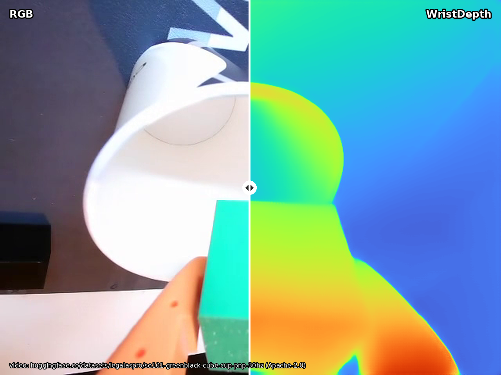

# WristDepth



<sub>[Announcement comparison video (23 s)](https://huggingface.co/christianengel/WristDepth/blob/main/media/wristdepth_long.mp4) · [15 s cut](https://huggingface.co/christianengel/WristDepth/blob/main/media/wristdepth_15s.mp4) · [SO-101 & ReBot wipe demo](https://huggingface.co/christianengel/WristDepth/blob/main/media/wristdepth-wipe.mp4) · [D405 sensor check](https://huggingface.co/christianengel/WristDepth/blob/main/media/wristdepth-sensor-check.mp4)</sub>

Metric depth for robot wrist cameras. Model: [christianengel/WristDepth](https://huggingface.co/christianengel/WristDepth)
(PyTorch + single-frame FP16 ONNX). Data: [christianengel/WristDepth-procedural](https://huggingface.co/datasets/christianengel/WristDepth-procedural) (98,180 Blender frames).

Stock monocular depth models misjudge gripper views by 2–4×; this repo renders procedural wrist-camera data and fine-tunes
[Depth Pro 2 B](https://github.com/apple-aiml-research/ml-depth-pro-2) for close manipulation range, cutting held-out DROID relative error over 10× while preserving depth shape across unseen labs.

| Held-out set | Stock Depth Pro 2 B (scale / AbsRel) | WristDepth (scale / AbsRel / `mae_log`) |
| --- | --- | --- |
| DROID wrist test (392 frames, other labs) | 2.27 / 1.445 | **1.00 / 0.132 / 0.115** |
| PennPAL (1,235 frames, excluded lab) | — | **0.99 / 0.158 / 0.169** |
| HOPE-Video Baxter / D415 (160 frames, unseen lab) | — | **0.92 / 0.123 / 0.129** |
| RoboLab wrist (748 simulated frames, PyTorch) | 2.92 / 2.135 | **1.09 / 0.237 / 0.215** |

Full deployed CUDA FP16 ONNX and PyTorch evaluations, synthetic dish geometry, and caveats are on the [model card](https://huggingface.co/christianengel/WristDepth). Earlier v1 pilot notes: [`research_notes/06_pilot_results.md`](research_notes/06_pilot_results.md).

## Try it on one wrist image

Use a rectified RGB image and the horizontal focal length from its camera calibration, in pixels at that image’s resolution. For a camera with `fx = 557.2` pixels, run this from the repository root.

```sh
uv run examples/predict_image.py wrist.png --fx-px 557.2
```

The first run downloads `onnx/model_fp16.onnx` from [christianengel/WristDepth](https://huggingface.co/christianengel/WristDepth). Inference runs locally on CPU. The example writes `wrist.depth.npy` with camera-axis depth in metres at the original image size, and `wrist.depth.png` with a fixed grayscale range from 5 cm (white) to 1 m (black). Pixels with missing depth are NaN in the metric array and black in the preview. It preserves the image aspect ratio and adjusts the focal length when fitting the frame to the model input.

## Pipeline

1. **Census** ([`research_notes/01`](research_notes/01_census.md)-[`05`](research_notes/05_assets_licenses.md)):
   camera, gripper, pose and appearance statistics of ~7,000 community LeRobot wrist datasets.
2. **Gripper** (`gripper/`): fit the SO-101 CAD jaw to real finger photos, export meshes posed
   in the camera frame.
3. **Render** (`procgen/`): BlenderProc/Cycles scenes with CC0 assets (Poly Haven, ambientCG),
   then a wrist-camera post-process (fisheye, exposure, blur, JPEG). `vast_render.sh` shards
   rendering over rented GPUs.
4. **Train** (`train/`): fine-tune decoder, head and the last encoder blocks; self-distil from
   the frozen base model on unlabelled community frames (`community/grab_frames.py`) to keep
   depth shape. `eval_sets.py` scores SO-101, DROID (val/test by scene) and RoboLab.
5. **Release** (`card/`): export with [depthpro2-onnx](https://github.com/protortyp/depthpro2-onnx)
   (`export_onnx.py --weights`), check parity, stage a model card from the results files.
6. **Dataset** (`dataset/build_hf.py`): write the renders as Hugging Face Parquet shards
   (`wrist` and `pinhole` configs, splits by scene).

`twin/`, `synth/` and `real/` hold the first pilot: a Gaussian-splat twin of one desk, MuJoCo
compositing, and real SO-101 captures with kinematic ground truth. The twin overfits to its
desk and is kept for diagnostics only.

## Setup

```sh
export WRIST_DEPTH_DATA=/path/to/data      # renders, runs, eval sets
export SO101_XML=/path/to/SO-ARM100/Simulation/SO101/so101_new_calib.xml
uv run --extra train python train/eval_sets.py base=B mine=B:/path/to/checkpoint.pt
```

Rendering runs in BlenderProc's own Blender (`uvx --from blenderproc blenderproc run
procgen/render.py ...`); see each script's header for its arguments.

## License

Code: Apache-2.0. Depth Pro 2 weights and their fine-tunes are under Apple's research-only
[model license](https://github.com/apple-aiml-research/ml-depth-pro-2). Evaluation data
(SpatialBench, community LeRobot frames) is used locally and not redistributed.
